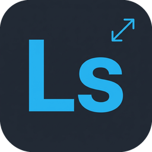

# LabScale

**Upscale AI dan boost 60 FPS untuk foto & video** — oleh Labstory Studio

Gratis · open source · semuanya diproses di komputermu sendiri

macOS (Apple Silicon) · Windows

[Unduh](https://apps.labstory.id/produk/labscale) ·
[Read in English](README.md) ·
[labstory.id](https://labstory.id) ·
[Instagram @labstory.studio](https://www.instagram.com/labstory.studio/)

---

LabScale memperbesar foto dan video beresolusi rendah dengan AI, dan membuat
video yang patah-patah jadi lebih mulus di 60 FPS. Masukkan satu file atau satu
folder, pilih yang kamu mau, tekan **Proses**.

## Kenapa LabScale

- 🆓 **Gratis** — open source, tanpa akun, tanpa watermark, tanpa batas
  jumlah file.
- 🔒 **Privat** — foto dan videomu diproses di komputermu sendiri dan tidak
  diunggah, dan file aslimu tidak pernah diubah. LabScale hanya memakai
  internet untuk mengecek versi baru dan, kalau kamu memilihnya, mengunduh
  model opsional.
- 🎬 **Foto *dan* video** — perbesar sampai 4×, dan buat video patah-patah
  jadi lebih mulus di 60 FPS.
- 📁 **Sekali banyak** — masukkan satu folder, lalu bandingkan sebelum dan
  sesudah dengan pembatas yang bisa digeser.

## Fiturnya

- **Upscale 1×–4×.** Kamu memilih menurut jenis gambarnya: foto, desain atau
  ilustrasi, anime, atau video anime. Ada juga mode draf cepat dan pilihan
  biasa tanpa AI.
- **Video 60 FPS**, dengan membuat frame-frame di antaranya: lewat model AI
  RIFE kalau GPU-nya mendukung, selain itu lewat interpolasi bawaan FFmpeg.
- **Satu folder sekaligus.** Setiap file tampil sebagai thumbnail, dan file
  yang sedang dikerjakan punya progress bar sendiri. Hasil dari satu folder
  dikumpulkan di folder `<nama folder>_upscaled`.
- **Bandingkan sebelum / sesudah.** Klik file mana saja untuk membandingkan
  asli dan hasilnya selebar jendela, dengan pembatas yang bisa digeser.
  ←/→ untuk pindah file.
- **Bisa dibatalkan kapan saja.** Sebelum memproses video dengan AI, LabScale
  juga mengecek ruang disk, bukan baru ketahuan penuh di tengah jalan.
- **Bahasa Indonesia dan Inggris**, ganti dengan satu klik.
- Untuk yang ingin tahu detail teknis: video disimpan sebagai H.264, HEVC,
  atau AV1, dan audionya tetap ikut. LabScale memakai encoder hardware kalau
  ada: VideoToolbox di Mac, NVENC di NVIDIA. Di GPU Intel dan AMD, LabScale
  mencoba Quick Sync dan AMF, yang belum diuji di perangkat sungguhan; kalau
  encoder hardware gagal, file dienkode ulang dengan CPU.

## Cara pasang

### macOS (Apple Silicon, macOS 14 atau lebih baru)

1. Unduh `LabScale-<versi>-macos.dmg` dari
   [Releases](https://github.com/labby245/lab-scale/releases/latest).
2. Buka, lalu seret **LabScale** ke **Applications**.
3. Saat pertama dibuka, macOS bilang app ini tidak bisa diverifikasi — LabScale
   (belum) ditandatangani sertifikat developer Apple berbayar. Klik **Done**,
   buka **System Settings → Privacy & Security**, gulir ke bawah, lalu klik
   **Open Anyway** di samping LabScale. Cukup sekali.

Mac Intel tidak didukung.

### Windows (10 / 11, 64-bit)

1. Unduh `LabScale-Setup-<versi>.exe` dari
   [Releases](https://github.com/labby245/lab-scale/releases/latest).
   (Tidak mau installer? Ambil `.zip`-nya dan jalankan `labscale.exe`.)
2. Kalau Windows SmartScreen menampilkan "Windows protected your PC", klik
   **More info → Run anyway**. Installer-nya tidak butuh hak administrator.

## Spesifikasi — apakah komputerku mumpuni?

Fitur AI (upscale AI dan RIFE) berjalan di **GPU** lewat Vulkan. Tanpa GPU yang
mendukungnya, LabScale tetap terbuka dan bisa dipakai, tapi hanya untuk upscale
tanpa AI (Lanczos) dan 60 FPS lewat FFmpeg, yang berjalan di CPU.

| | Hanya fitur dasar | Minimum untuk AI | Disarankan |
|---|---|---|---|
| **Mac** | — | Apple M1, macOS 14, RAM 8 GB | Apple M1 atau lebih baru, RAM 16 GB untuk video |
| **Windows** | Windows 10/11 64-bit, GPU tanpa Vulkan | GPU dengan Vulkan, VRAM 2 GB, RAM 8 GB | GPU kelas GeForce GTX 1650 / Radeon RX 570 ke atas, VRAM 4 GB, RAM 16 GB |
| **Contoh GPU Windows** | Intel HD Graphics generasi ke-3 sampai ke-5 (mis. HD 4000), GeForce lama berbasis Fermi (mis. GT 720M) | Intel HD/UHD generasi ke-6 (2015) ke atas, NVIDIA GeForce GTX 650 / GT 740M (Kepler) ke atas, AMD Radeon HD 7000 / R7 / R9 (GCN) ke atas | NVIDIA GTX 10/16 atau RTX, AMD RX 400 ke atas |
| **Yang bisa dikerjakan** | Upscale tanpa AI, 60 FPS lewat FFmpeg (lambat di CPU lama) | Upscale AI foto; video AI pendek | Upscale AI foto dan video, RIFE 60 FPS |
| **Ruang disk** | ±400 MB untuk app | sama, plus ruang sementara untuk video | 20 GB+ kosong untuk video AI panjang |

**Cara paling pasti:** buka LabScale, lihat titik di bilah bawah. Kalau
**Real-ESRGAN** dan **RIFE** hijau, fitur AI bisa jalan di komputermu. Kalau
abu-abu, klik **Setup & Status** untuk melihat alasannya.

Gambaran kecepatan, diukur di MacBook Pro M1: satu foto hasil 1920×1280 butuh
±6,5–7 detik dengan model foto, atau ±0,7 detik dengan "Draf cepat". Di laptop
tanpa GPU Vulkan (contoh: Core i3 generasi ke-3 dengan GT 720M), fitur AI tidak
tersedia, dan 60 FPS lewat FFmpeg berjalan sangat lambat.

**Yang sudah kami uji langsung:** MacBook Pro M1 (semua fitur) dan laptop
Windows 10 tanpa Vulkan (fitur dasar). Daftar GPU Windows di atas disusun dari
dukungan Vulkan resmi masing-masing produsen, belum dari pengujian kami di
setiap GPU. Titik status di app tetap penentu yang paling pasti.

## Perlu diketahui

- **Upscale video dengan AI itu berat.** Setiap frame di-upscale satu per satu,
  jadi cocok untuk klip pendek. LabScale memperkirakan ruang disk sementara
  yang dibutuhkan dan memberi tahu di awal kalau tidak cukup.
- **2× sama beratnya dengan 4×** di kebanyakan model AI — modelnya hanya punya
  bobot 4×, jadi LabScale menjalankan 4× lalu memperkecilnya. Pengecualiannya
  "Video anime": punya bobot 2× dan 3× sendiri dan jauh lebih cepat.
- **Tiga model opsional diunduh saat kamu memilihnya** — UltraMix Balanced,
  UltraSharp, dan Remacri (sekitar 33 MB masing-masing). Lisensinya hanya untuk
  **pemakaian non-komersial** (CC BY-NC-SA 4.0); model yang ikut installer
  tidak punya batasan itu.
- **Pembaruan.** Saat dibuka, LabScale mengecek GitHub apakah ada versi baru
  dan menampilkan banner kecil kalau ada. LabScale tidak pernah mengunduh atau
  memasang apa pun sendiri.
- **Ada masalah?** Klik ikon ⓘ → **Buka folder log**, lalu lampirkan
  `labscale.log` di [issue baru](https://github.com/labby245/lab-scale/issues).
- **Pertanyaan lain?** Kirim email ke
  [hello@labstory.id](mailto:hello@labstory.id).

## Dibangun dengan

LabScale adalah app Flutter yang menjalankan tiga tool open source:

- [FFmpeg](https://ffmpeg.org) — dekode, enkode, filter
- [Real-ESRGAN](https://github.com/xinntao/Real-ESRGAN) (ncnn Vulkan) — upscale AI
- [RIFE](https://github.com/hzwer/Practical-RIFE) (ncnn Vulkan) — interpolasi frame AI

Kredit dan lisensi lengkap: [THIRD_PARTY_NOTICES.md](THIRD_PARTY_NOTICES.md).
Membangun dari source: [docs/DEVELOPMENT.md](docs/DEVELOPMENT.md).

## Juga dari Labstory Studio

**[Fotolane](https://apps.labstory.id/produk/fotolane)** — siapkan foto
event secara otomatis. Ribuan foto event di-resize dan dipilah siap unggah
tanpa perlu ditunggui.

## Lisensi

Kode LabScale berlisensi [MIT](LICENSE). Tool dan model yang dibundel punya
lisensi masing-masing — lihat [THIRD_PARTY_NOTICES.md](THIRD_PARTY_NOTICES.md).
